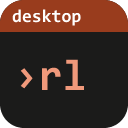

# rules-desktop

A local web UI and desktop app for the rule set of [rules.nvim](https://github.com/WKDSteve/rules.nvim):
browse the rules, search them, and later create, change, retire and move them, in the browser first and as a small
native app after that. The sibling of [tasks-desktop](https://github.com/WKDSteve/tasks-desktop), built on the same
parts and meant to look and behave like it.

**Status: early development. No release yet.** The newest state of `main` is on the pre-release [`latest`](https://github.com/WKDSteve/rules-desktop/releases/tag/latest) (a Windows program, rebuilt after every green CI run, unsigned; a plain download, no GitHub login needed). The interface reads and writes: you can make, change, retire, reinstate and move rules, several at once, with Undo and a conflict center. It reads: the hub serves families, rules,
search, findings and the rule detail, follows the rule files live and passes its security matrix, axe and a corpus of
hostile rules in the browser. The native shell and the waivers follow the phases below. It is not a release: use it to look, not to rely on. How to
use it: [docs/USAGE.md](docs/USAGE.md), a walk through one sitting in [docs/WORKFLOW.md](docs/WORKFLOW.md); what it does about security: [docs/SECURITY.md](docs/SECURITY.md).

## What it is for

`rules.nvim` loads a rule set from Markdown files, where every rule is a fenced `rule` block with the prose under it,
and checks a project against it. It is an engine with no rules of its own. What it does not have yet is a way to *write*
rules: find the next free id of a family, add a block without touching the text around it, retire a rule without ever
reusing its id. That is what `tasks.nvim` has for tasks, and this app is the window onto it.

It is **not** a place to run the checks or to let an agent work the manual rules: that stays in
[docmap-desktop](https://github.com/WKDSteve/docmap-desktop). This app is about the rule set itself.

## Principles

- **The engine is the only writer.** The app never parses or formats a rule block. It talks to rules.nvim through
  versioned documents (`rules-export/1` to read, `rules-ops/1` to write), the same shape tasks.nvim uses for tasks.
- **The text around a rule is not touched.** Writing replaces exactly one block; everything else in the file stays
  byte for byte. A block that holds code (a function, a comment) is shown, not rewritten.
- **Loopback only, token always.** Host and Origin are checked, there is no data endpoint without a session.
- **Data classes fail closed.** A rule set source without an entry in the per-device configuration is treated as not
  released; public and private rule sets are never mixed.
- **A rule set is code.** The app never runs a rule's `check`, and rule text is shown as text.
- rules.nvim stays a pure Lua plugin. This repository holds the hub, the UI and the native shell.

## Plan

| Phase | What |
| --- | --- |
| format | decide the storage format by measuring a round trip over every rule block of the real rule sets |
| lib, engine | the shared contract modules in lib.nvim, then `rules-export/1` and `rules-ops/1` in rules.nvim |
| nvim | `:Rules new`, `set`, `retire`, `move`, `list` in Neovim, useful without this app |
| shared | the parts this app has in common with tasks-desktop (server guard, sessions, shell, design tokens) move into one shared kit |
| ui-read | the hub and a read-only interface: families, rules, findings, search |
| ui-write | create, change, retire and move rules, conflict center, undo |
| shell | a thin native shell (Tauri), installer |
| waiver | waivers and coverage |

The planning notes live outside this repository, in the maintainer's task vault.

## Layout

```
crates/rules-hub/   the hub: routes, engine method list, adapters, on appkit (see below)
ui/                 the browser interface (Svelte 5, Vite, TypeScript)
ui/e2e/             browser tests (Playwright, axe) against the real binary and the real engine, with a synthetic rule set
src-tauri/          the native shell (later)
docs/               usage, security, releasing
engine.lock         the rules.nvim and lib.nvim commits this is built and tested against
```

A test that needs a folder in the temp dir gets it from `Scratch` (Rust, `crates/rules-hub/tests/common/scratch.rs`)
or from `ui/e2e/cleanup.ts` (browser tests), which remove it again, also after a failure; `crates/rules-hub/tests/temp_hygiene.rs`
refuses a folder named by hand; `scripts/test-install.ps1` fails when it cannot remove its folder (tried again for a
file held for a moment). `python tools/check-temp-leftovers.py` lists what is left of `rules-desktop-*` and
`rules-hub-*` in the temp dir; CI gives its test jobs a temp dir of their own and runs it there (`--strict` for Rust).

## Running the hub

The program is `rules-hub`; its verbs are those of `tasks-hub`:

```
rules-hub serve [--port N]      run the hub until Ctrl-C
rules-hub start [--open]        run it in the background (log in the config folder)
rules-hub stop                  stop that hub
rules-hub open [--launch]       print (or open) a one-time pairing link
rules-hub autostart on|off|status
rules-hub install [--autostart] [--shortcut]
rules-hub uninstall [--purge-settings]
```

To install it for your user without administrator rights, see [Install](#install) below.

It needs a Neovim (0.12 or newer), a rules.nvim checkout and the rules vault: `RULES_NVIM`,
`RULES_ENGINE_DIR` (else `$REPOS_DIR/rules.nvim`) and `RULES_VAULT`, or the same as keys of
`config.json` in the config folder (`%APPDATA%\rules-desktop`, `~/.config/rules-desktop`;
`RULES_DESKTOP_CONFIG_DIR` moves it). The default port is 17616 (`RULES_DESKTOP_PORT`). Which rule set
may be shown as what is decided per device in `sources.json` in the same folder; a rule set without an
entry is shown as unclassified, and a `sources.json` that cannot be read stops the start.

## Install

There are two channels, and both carry an install script that installs exactly their build:

- **A release** (a tag `vX.Y.Z`, published by hand after a draft was tried).
- **The rolling build** (the pre-release `latest`): the newest green commit of `main`, rebuilt after every CI run,
  for trying what is new and not for anything that matters.

Both are Windows only: the builds run on the maintainer's self-hosted Windows runner (see [docs/RELEASING.md](docs/RELEASING.md)); there is no Linux or macOS archive and no
`install.sh`.

The scripts need no administrator rights and install for one user, so they also work where SmartScreen stops a
downloaded program. Run them in your own terminal (not elevated, not from inside a program that sandboxes AppData).
The repository is public: the script is a plain download, with no GitHub login and no token:

```
# the rolling build (Windows)
irm https://github.com/WKDSteve/rules-desktop/releases/download/latest/install.ps1 -OutFile $env:TEMP\install.ps1
& "$env:TEMP\install.ps1"

# a release: the same with the tag in place of latest, e.g. .../releases/download/v0.1.0/install.ps1
# (once there is a release, .../releases/latest/download/install.ps1 is the newest one)
```

`irm -OutFile` leaves no download mark on the file. A script saved from the release page with the browser carries
one, and PowerShell refuses it as unsigned ("is not digitally signed"): run `Unblock-File` on it first.

They download the program of that build, check it against its `SHA256SUMS` (a wrong or missing checksum installs
nothing), and hand over to `rules-hub install`, which replaces the program in one step and brings a running hub
back. The installation that is there is found and replaced, never a second one beside it: the script of `latest` run
again updates to the newest rolling build, the script of a release run again repairs that release (to update, take
the script of the newer release, or pass `-Version`/`-Rolling`). To pass arguments, add them to the call:
`& "$env:TEMP\install.ps1" -InstallArgs '--shortcut'` adds a link. Nothing registers the hub with your login by itself: the Help menu of the page has a switch, as has `rules-hub autostart on|off`.
`-File FILE` installs from a file you already have, with `-Sums FILE` or `-Sha256 HEX`. Through
`powershell -File` an array arrives as one string, so a saved `install.ps1` takes one `-InstallArgs` value there; in a
PowerShell session a list is fine. The install
scripts are the ones of appkit's [release-kit](https://github.com/WKDSteve/appkit/tree/main/release-kit), stamped
for this app and the channel when they are attached; `scripts/test-install.*` try the script of the pinned kit
against the hub in the CI of every commit and in the build of every release.

**Or build this checkout and install it** (Windows; Rust and Node):
the same steps as the rolling build, then `rules-hub install` of the program built here. Nothing is downloaded but the packages
of the lock files, and a file built on the machine carries no mark for SmartScreen to stop.

```
.\scripts\build-install.ps1 [-BuildOnly] [-InstallArgs '--shortcut']
```

```
.\scripts\uninstall.ps1 [-PurgeSettings]
sh scripts/uninstall.sh [--purge-settings]        # Linux/macOS, from source; not run by CI any more
```

Uninstalling stops the hub, takes away the login entry and the link, and removes the program. Your settings stay
unless you ask; your vault and your rule sets are never touched. How a release is made:
[docs/RELEASING.md](docs/RELEASING.md).

## The shared kit

The server guard, sessions, pairing, limits and the login entry come from
[appkit](https://github.com/WKDSteve/appkit), the kit tasks-desktop is built on too. It is a git dependency pinned
by its tag in `Cargo.toml`, and the page takes the kit's browser part, `appkit-ui` (design tokens, base rules, menu bar,
markdown reader and more), from the same tag in `ui/package.json`. `tools/check-appkit-pin.py` checks that both lock
files hold one tag and one commit and that the tag still names it; `tools/check-color-literals.py` refuses a hex colour or
colour function where the CSS of the page states a colour (declarations, style attributes and directives, SVG paint
attributes), so those colours are tokens of the kit or of `ui/src/palette.css`, the palette that gives them the colours
of the app's icon (generated by the palette tool of the app icons, loaded after the kit's tokens, never edited here); scripts, `.ts` and `.svg` files and named colours are not looked at.
The hub already starts on it and passes the kit's security matrix (`crates/rules-hub/tests/security.rs`); it has its
own names (config folder `rules-desktop`, program `rules-hub`, port 17616, routes under `/api/rules/`). Behind a
session it reads the engine (`rules-export/1`, read only): `snapshot` (the engine's document, its digest as `ETag`),
`rule?id=` (only an id of the held snapshot is ever passed to the engine) and `about` (the app and the engine's
version). The tests answer with copies of the engine's golden documents (`crates/rules-hub/tests/fixtures/golden`),
which CI compares with the pinned engine. Its commands and views come with the rest of the read-only UI phase.

To try a change of appkit before it has a tag, point the crates at a local checkout in a `.cargo/config.toml` that is
not committed (`[patch."https://github.com/WKDSteve/appkit"]`). That rewrites `Cargo.lock`: restore it with
`git checkout -- Cargo.lock` before a commit, then run the pin check.

## License

MIT, see [LICENSE](LICENSE).
